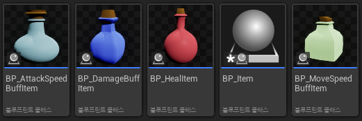
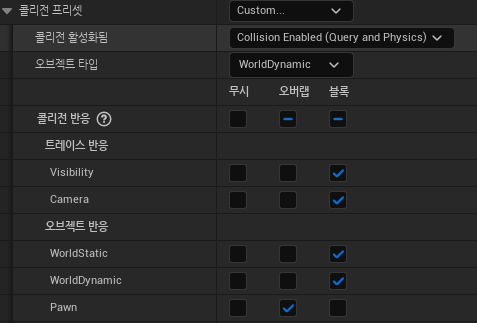
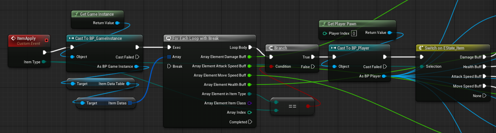

아이템들을 같은 종류로 묶기 위해 BP_Item이라는 공통 부모 클래스에서 파생된 아이템 클래스들을 각각 만들었다.

**BP_Item**

매 틱마다 addRotation을 통해 아이템이 z축 기준으로 빙글빙글 돌게 했다.

다른 액터와 닿았을 시, 플레이어 클래스로 캐스팅을 시도하고 자신의 현재 타입을 아이템매니저에 넘겨주어 효과 적용 명령을 내린다.
이때, 모든 액터에 닿았을 때마다 불필요하게 캐스팅을 시도하지 않게 콜리젼 프리셋에서 Pan에만 오버랩을 감지하게 설정했다.

**ItemMamager**

받아온 타입에 맞는 엘리먼트를 아이템 데이터 테이블에서 찾아 그에 맞는 값으로 플레이어에게 효과를 적용한다.