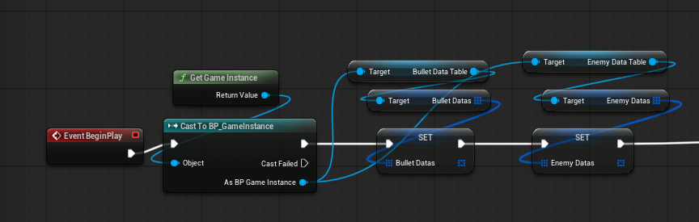
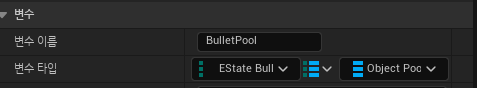
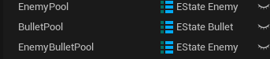
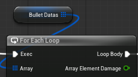
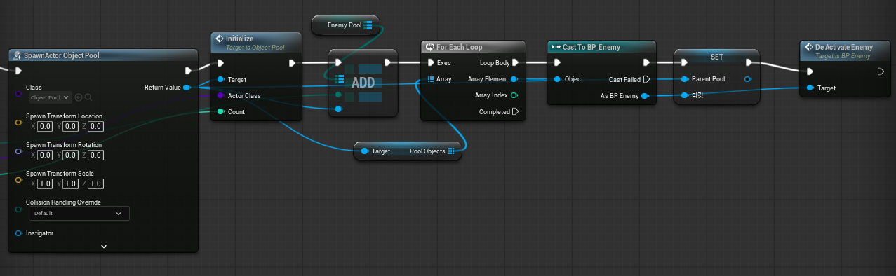
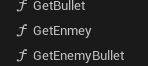
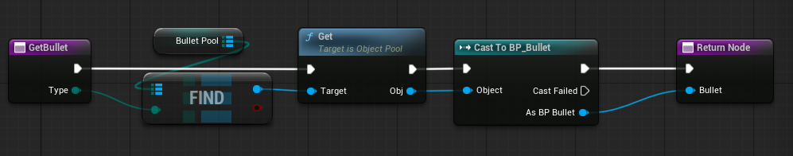

**PoolManager**

게임 시작 시, 게임인스턴트스에 저장된 데이터 테이블들의 참조를 받아옵니다.

유니티에서 서로 다른 Dictionary<>를 통해 각 오브젝트 풀들을 관리했던 것처럼 ObjectPool을 액터 레퍼런스 타입을 Value로 가지고 각 PoolObject들의 타입을 Key로 가진 Map 변수들을 선언했습니다.
PoolObject라 해서 종류가 하나만 있는 게 아니고 Bullet이면 Base, Improved, Slime등 같은 탄환이라도 종류가 여러가지이기 때문입니다.

각 데이터 테이블을 ForEach Loop를 통해 순회하며 PoolObject들마다 각 타입의 ObjectPool들을 생성하고 Map에 Add합니다.
그리고 ObjetPool 클래스는 각 PoolObject들에게 공통으로 사용되고 오브젝트들은 액터 레퍼런스 타입으로 저장하고 있기에 자신이 어떤 PoolObject를 지니고 있는지 모릅니다.
따라서 PoolObject를 특정 타입으로 캐스팅해도 되는 PoolManager에서 캐스팅을 진행해 PoolObject들을 초기화시켰습니다.

다른 클래스들에서 PoolManager를 통해 곧바로 PoolObject들에게 접근하게 하기 위해 Get__ 함수들을 만들고 Map에서 넘겨받은 타입에 맞는 ObjectPool을 찾아 PoolObject를 넘겨주게 했습니다.

**ObjectPool**

PoolManager에서 넘겨받은 클래스 타입을 바탕으로 액터를 Spawn하고 배열에 Add합니다.

Get 함수에서는 다른 클래스에서 오브젝트를 가져오려 할 때 현재 배열이 비어 있는지 체크하고 만액 비어있을 시에는 새로운 오브젝트 하나를 새로 만들어 넘겨주고 그렇지 않을 경우에는 배열의 마지막 인덱스에 위치한 오브젝트를 넘겨주고 해당 인덱스를 제거합니다.

다른 클래스에서 오브젝트의 사용이 끝났을 때 호출되는 함수로 받은 오브젝트를 다시 배열에 넣습니다.

