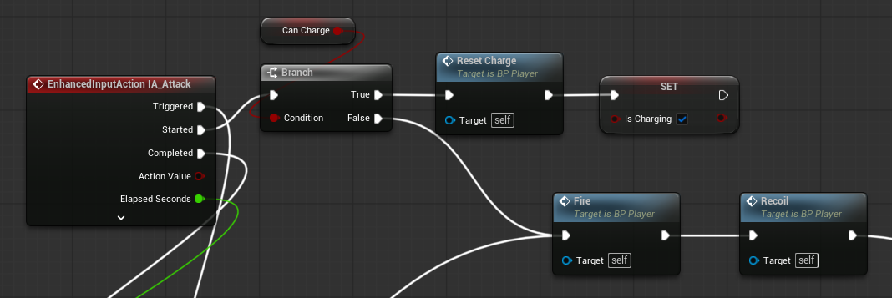

Started(처음 한 번 눌렸을 때)에는 현재 탄환의 차지 유무를 판단하고 차지가 아닐 시, 탄환을 바로 발사하고 차지일 시, 기존 차지량을 리셋하고 IsCharging을 True로 할당하는 등, Triggered에서 실행될 차지 로직을 위한 준비를 한다.

PoolManager는 총알을 관리하고 빌려주고 플레이어는 실제 발사 로직을 담당하는 거로 역할을 분리하기 위해, 총알의 위치와 회전값은 플레이어가 설정하게 했다.

플레이어의 위치에서 탄환을 바로 발사하면 탄환이 플레이어에 닿을 수 있기에, Muzzle(총구)를 추가해 그것을 기준으로 값을 설정하게 했다.
BP_Player는 총구의 회전값의 앞 벡터에 Force를 곱해 BP_Bullet에게 넘겨준다.

탄환에 가해줄 힘과 탄환 발사 위치의 백터값을 곱해 속도로 넘겨준다.
이때 카메라가 바라보는 pitch축 방향에 따라 탄환이 발사돼야 하므로 IA_Look에서 받아온 Pitch값도 별도로 곱해준다.
차지 보너스에 앞에서 구한 차지량을 구해 차지량에 따른 데미지 증가를 구현했다.

