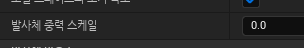
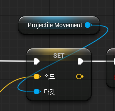
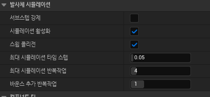

이때, PoolManager에서 게임 시작 시, 탄환이 생성된 후에 물리,콜리젼,위치를 초기화했음에도 탄환들이 Z축의 -방향으로 매우 빠르게 이동하는 현상이 발생했다
또한, 원래라면 공격 버튼을 눌렀을 때 탄환이 총구 위치로 이동하고 속도가 0으로 초기화된 다음 Add Impulse를 통해 발사돼야 하는데 플레이어 위치로 이동된 직후 플레이어가 바라보는 방향이 아닌, Z축 -방향으로 빠르게 이동하는 게 지속되었다.
탄환이 플레이어와 멀어져서 속도가 초기화되고 레벨에서 숨겨지는 거리가 1000 이상부터인데, 현재 탄환은 Z축 -방향으로 1초에 거의 2000씩 이동한다.
그렇기에 탄환을 발사한 직후 바로 이벤트 틱의 조건문에 걸리는데 이때 로그는 찍히지만, 속도는 초기화되지 않아 탄환이 계속해서 이동한다.

탄환이 처음 생성됐을 때 Z축 -방향으로 이동되는 게 초기화되지 않고 계속 지속되는 바람에 이런 현상들이 일어나는 것으로 추정된다.

발사체 중력 스케일을 0으로 설정했더니 더 이상 탄환이 혼자 움직이지 않았다.
속도가 0임에도 Projectile Gravity Scale의 중력 영향을 받아 Z축 속도가 점점 감소됐던 것으로 추정된다.

AddForce와 AddImpulse은 여러 물리 과정을 거쳐 물리적인 힘을 가하는 방식이지만 탄환을 발사할 때 굳이 물리 엔진이 들어갈 필요는 없으므로 Projectile Movement를 이용해 정해진 속도로 물체를 날아가게 했다.

근데 여기서 탄환이 플레이어 앞에 소환되기만 하지, 가해준 속도로 움직이지 않는 현상이 발생했다.

버그 해결 : 코드 상에는 문제가 없었지만 Projectile Movement 컴포넌트의 시뮬레이션 활성화가 off로 설정돼 있어서 발사체가 날아가지 않았던 것이였다.
on으로 설정하니 지정한 속도로 제대로 날아갔다.
