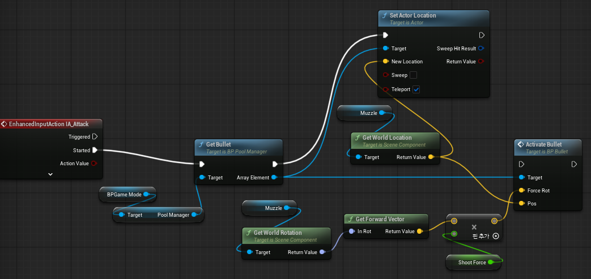
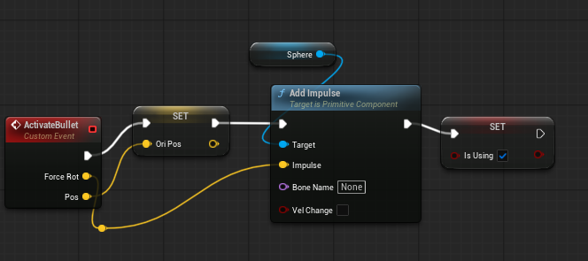
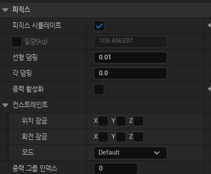

탄환은 활성화된 직후, 플레이어에게서 값을 받은 값을 토대로 작동한다.
이후 로직에서 쓰기 위해 발사 위치를 저장하고, IsUsing을 True로 설정한다.
탄환은 즉각적으로 발사되는 느낌이 더 어울리기에, Add Impulse를 사용했다.

Event Tick에서 매 프레임마다 이전에 저장해둔 발사 위치와 현재 탄환의 위치를 Distance로 비교하며 일정 거리 아상 떨어졌을 시, 속도를 초기화하고 IsUsing을 다시 false로 설정한다.

Impulse를 사용하고 있기에 탄환의 Simulate Physics는 키고 탄환이 아래로 가라앉는 걸 막기 위해 Use Gravity는 껐다.
