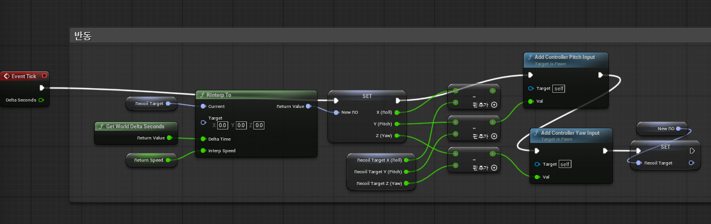
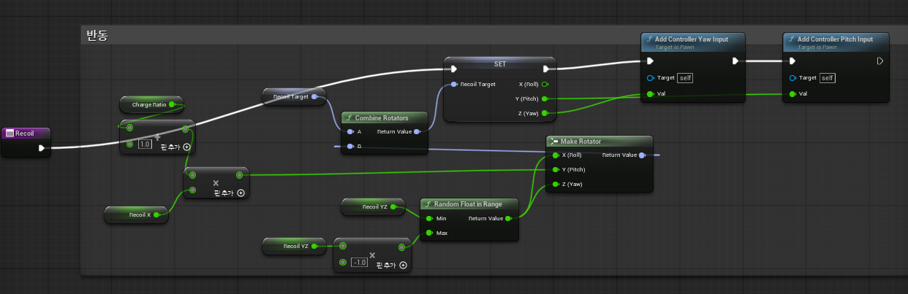

여기서는 탄환 발사 시 튕겨진 화면을 다시 원래대로 되돌리는 작업을 진행합니다.
Event Tick에서는 목표 회전값을 적당한 속도로 0으로 보간하며 매 프레임마다 조금씩 보간된 값에서 원래 목표 회전값을 뺀 후 컨트롤러 회전값에 더하고 목표 회전값을 보간된 값으로 Set했습니다

이곳에서는 화면을 튕기는 역할만 하지, 다시 제자리로 돌아오게 하지는 않습니다.
탄환 발사 시, x축 기준으로 회전할 값(위로 튕기게 하는 값)을 Pitch로, y와 z축 기준으로 회전할 값(좌우로 흔들릴 값)을 랜덤한 범위 내에서 구해서 Roll과 Yaw로 가진 로테이터를 하나 만들고, 현재 목표로 하고 있던 타겟 로테이터에 더해주고 RecoilTarget로 Set해 갱신해 줍니다.
그런 후, Pitch와 Yaw 값을 컨트롤러 회전값에 더해줬습니다.

